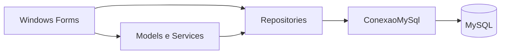

<div align="center">

# 🛡️ CyberDesk

### Security Incident & Asset Management

**Sistema desktop de gestão de ativos, incidentes e análise de riscos de segurança da informação.**

Construído com **C#**, **Windows Forms** e **MySQL**, aplicando Programação Orientada a Objetos, regras de negócio, persistência de dados e uma arquitetura organizada em camadas.

<p>
  
  
  
  
</p>

**Desktop Application · Object-Oriented Programming · Data Persistence · Cybersecurity**

</div>

> 📌 **Publicação em andamento:** a documentação está disponível; os arquivos da solução Visual Studio serão adicionados ao repositório pelo autor.

---

## 🎯 Visão geral

O **CyberDesk** é uma aplicação acadêmica de portfólio que simula o fluxo de trabalho de uma equipe de TI: do inventário de equipamentos ao registro, à priorização, ao acompanhamento e à análise de incidentes de segurança.

**Problema abordado:** controles dispersos dificultam relacionar incidentes aos equipamentos afetados, identificar prioridades e acompanhar a evolução dos atendimentos.

**Solução desenvolvida:** um sistema desktop integrado a um banco de dados relacional, com cadastros, consultas, histórico de status e relatórios gerenciais.

> **Destaque técnico:** a aplicação vai além de um CRUD tradicional: aplica validações no domínio, calcula riscos automaticamente e registra alterações de status com transações no MySQL.

## ✨ Funcionalidades

| Módulo | Recursos |
|---|---|
| 📊 **Dashboard** | Indicadores de incidentes e ativos, pesquisa e incidentes recentes. |
| 🖥️ **Ativos** | Cadastro, consulta, edição e exclusão de equipamentos; validação de IP e proteção contra duplicidades. |
| 🚨 **Incidentes** | Registro vinculado a um ativo, cálculo de risco, acompanhamento e mudança de status. |
| 🕓 **Histórico** | Rastreabilidade das transições de status, filtros por período e exportação CSV. |
| 📈 **Relatórios** | Indicadores, gráficos por risco e status, ranking de ativos e exportação CSV. |

## 🧠 Regra de negócio: classificação de riscos

Cada incidente recebe dois valores de **1 a 5**: impacto e probabilidade.

**Pontuação = Impacto × Probabilidade**

| Pontuação | Classificação |
|---|---|
| 1–4 | 🟢 Baixo |
| 5–9 | 🔵 Moderado |
| 10–16 | 🟠 Alto |
| 17–25 | 🔴 Crítico |

Exemplo: um incidente com impacto **4** e probabilidade **5** recebe **20 pontos**, sendo classificado como **Crítico**. Esse modelo é uma regra didática de priorização, não uma avaliação formal de risco corporativo.

```csharp
public static int Calcular(Incidente incidente)
{
    if (incidente == null)
        throw new ArgumentNullException("incidente");

    return incidente.Impacto * incidente.Probabilidade;
}
```

## 🏗️ Arquitetura

O projeto separa a apresentação das regras de negócio e do acesso a dados, facilitando manutenção, testes e evolução.



```text
CyberDesk/
├── Forms/                 # Dashboard, ativos, incidentes, histórico e relatórios
├── Models/                # Ativo, Incidente, HistoricoIncidente e DTOs
├── Services/              # Cálculo de risco, Collections e relatórios
├── Repositories/          # Operações de persistência e consultas SQL
├── Data/                  # Gerenciamento da conexão MySQL
├── Exceptions/            # Exceção de validação personalizada
├── Enums/                 # Estados dos incidentes
├── Controls/              # Componentes gráficos próprios
├── Database/              # Script de criação do banco
└── Program.cs             # Inicialização da aplicação
```

*A árvore representa a organização lógica utilizada no desenvolvimento. Os arquivos do Visual Studio e do Designer podem aparecer em outras pastas conforme a solução publicada.*

### Conceitos de engenharia aplicados

- **POO:** classes de domínio, encapsulamento, propriedades, múltiplos construtores e métodos com responsabilidades definidas.
- **Collections:** gerenciamento de objetos em `List<Incidente>` e manipulação de listas para filtros e indicadores.
- **Tratamento de erros:** `ValidacaoCyberDeskException`, validação de entrada e respostas a erros de banco de dados.
- **Integridade relacional:** chaves estrangeiras entre ativos, incidentes e histórico; unicidade do IP no banco.
- **Persistência:** repositórios SQL e consultas parametrizadas com `MySqlConnector`.
- **Consistência:** alteração de status e inserção do histórico executadas na mesma transação.
- **Visualização:** dashboard e gráficos implementados no Windows Forms, com exportação CSV.

## 🧰 Tecnologias

| Tecnologia | Utilização |
|---|---|
| **C# / .NET** | Domínio, validações, regras de negócio e manipulação de dados. |
| **Windows Forms** | Interface gráfica desktop orientada a eventos. |
| **MySQL** | Persistência, integridade referencial, consultas e transações. |
| **MySqlConnector** | Comunicação entre C# e MySQL. |
| **Visual Studio** | Desenvolvimento, depuração e execução. |
| **Git / GitHub** | Versionamento e documentação do projeto. |

## 🚀 Como executar localmente

**Pré-requisitos:** Windows, Visual Studio com suporte a Windows Forms, .NET compatível com o arquivo `.csproj` da solução, MySQL Server (recomendado 8.0.16+) e MySQL Workbench (opcional).

1. Clone o repositório e abra o arquivo `.sln` no Visual Studio.
2. Restaure as dependências NuGet; o projeto utiliza **MySqlConnector**.
3. Execute o script `Database/01_criar_banco_cyberdesk.sql` no MySQL.
4. Configure a variável de ambiente de usuário **`CYBERDESK_MYSQL_CONNECTION`** no Windows:

   ```text
   Server=localhost;Port=3306;Database=cyberdesk;User ID=SEU_USUARIO;Password=SUA_SENHA;
   ```

   Substitua os marcadores pela sua configuração local. **Não salve credenciais reais no repositório**. Reinicie o Visual Studio após configurar a variável de ambiente.
5. Defina `frmPrincipal` como formulário inicial em `Program.cs`, se ainda não estiver configurado.
6. Compile e execute (`F5`). Cadastre um ativo antes de registrar incidentes.

> A aplicação requer acesso a um servidor MySQL configurado. O README não inclui credenciais nem dados privados.

## 🧪 Fluxo de demonstração

1. **Dashboard:** visualizar os indicadores e recarregar os registros.
2. **Ativos:** cadastrar dois equipamentos, testar IP inválido e tentar repetir um endereço IP.
3. **Incidentes:** associar uma ocorrência a um ativo e conferir a classificação automática de risco.
4. **Histórico:** alterar o status de um incidente e consultar a transição registrada.
5. **Relatórios:** atualizar os gráficos, filtrar dados e exportar um CSV.

O sistema foi exercitado manualmente nos cinco formulários durante o desenvolvimento acadêmico. **Esta descrição não representa uma suíte automatizada de testes ou uma auditoria de segurança.**

## 🔒 Considerações de segurança

- A string de conexão é obtida de uma **variável de ambiente**, evitando credenciais fixadas no código-fonte.
- Os repositórios utilizam **consultas parametrizadas** para operações com dados de entrada.
- As regras de domínio impedem informações inválidas e os vínculos relacionais protegem a consistência do banco.
- O histórico demonstra rastreabilidade de status; nesta versão acadêmica, a exclusão de um incidente também pode excluir seu histórico por `ON DELETE CASCADE`.

**Escopo:** protótipo acadêmico/portfólio, não uma plataforma de SOC pronta para produção. Autenticação, permissões, proteção avançada de segredos e retenção imutável de auditoria são possíveis evoluções.

## 🛣️ Evoluções possíveis

- Autenticação e perfis de acesso (administrador e analista).
- Arquivamento lógico de incidentes para preservar auditoria.
- Exportação PDF e indicadores históricos por período.
- Testes automatizados de regras de negócio e persistência.
- Auditoria mais detalhada e estratégias de backup.

## 🎓 Contexto acadêmico

Projeto desenvolvido para **Linguagem de Programação 2**, no curso de **Análise e Desenvolvimento de Sistemas do IFSP**. O objetivo é demonstrar, em uma aplicação integrada, os conceitos de **Programação Orientada a Objetos, interface gráfica, Collections, exceções, validação de dados e comunicação com banco de dados**.

## 👨‍💻 Autor

**Nicolas Daniel** — Desenvolvimento de Software e Segurança da Informação

[](https://github.com/nicolasdanieldev)
[](https://www.linkedin.com/in/nicolasdanielsantos/)

---

<div align="center">
  <sub>CyberDesk · C# · Windows Forms · MySQL · Portfolio Project</sub>
</div>